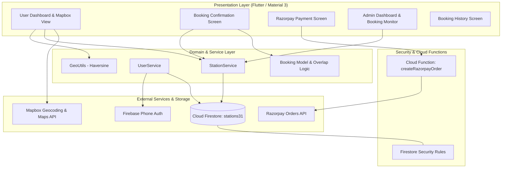
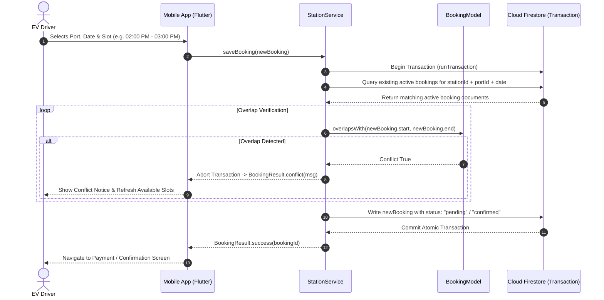

<div align="center">

# ⚡ AmpTrail

### Production-Grade EV Charging Discovery, Slot Booking & Station Management System

<p>
  
  
  
  
  
  
  
  
</p>

</div>

---

## 📋 Overview

**AmpTrail** is a full-featured, production-ready EV charging ecosystem designed to eliminate friction in electric vehicle mobility. It allows drivers to discover nearby charging stations via an interactive high-performance Mapbox interface, verify connector specifications (CCS2, Type 2, CHAdeMO) and pricing in real time, and reserve charging slots using **concurrency-safe atomic database transactions**.

The ecosystem includes:
- **Mobile Client (Flutter)**: Real-time map discovery, place search, filter chips, favorites caching, slot reservation, and Razorpay payment checkout.
- **Operator Admin Dashboard**: Station-level pending reservation streams, live slot monitoring, and 1-tap booking acceptance/rejection workflows.
- **Backend & Cloud Architecture (Firebase)**: Cloud Firestore multi-tenant security rules, transactional booking concurrency, and Node.js Cloud Functions order creation.

---

## 🏛️ System Architecture

AmpTrail follows a **Clean, Layered Architecture** separating presentation state, domain services, and external I/O integrations.



---

## 🔒 Concurrency Control & Double-Booking Prevention

In high-density EV charging stations, double-booking identical physical ports during the same time window is a critical domain failure. AmpTrail resolves this with **Optimistic Concurrency Control using atomic Firestore Transactions (`_firestore.runTransaction`)**.

### Transaction Sequence Flow



---

## 🛡️ Security Hardening

| Area | Implementation Details |
|---|---|
| **Credential Centralization** | All third-party secrets (`MAPBOX_TOKEN`, `RAZORPAY_KEY_ID`, `RAZORPAY_KEY_SECRET`) centralized in `lib/config/api_keys.dart`. |
| **Git Leak Protection** | `api_keys.dart`, `.env*`, `service-account*.json`, and private keys strictly `.gitignore`d. An `api_keys.example.dart` template is provided for CI and team onboarding. |
| **Payment Order Security** | Razorpay key secret is never exposed to the client. Cloud Function `createRazorpayOrder` creates authenticated server-side orders via HTTP callable with verified `context.auth`. |
| **Firestore Security Rules** | Full production `firestore.rules` enforcing role-based writes, authenticated reads, schema validation, and admin privilege verification. |
| **Admin Privilege Verification** | `UserService.isUserAdmin()` cross-references Firebase Custom Claims and privileged `/admins/{uid}` Firestore collections before routing. |

---

## ⚡ Performance Optimizations

1. **Repaint Boundaries & Subtree Isolation**: Mapbox map instances wrapped in `RepaintBoundary` to prevent cascading render repaints during bottom sheet drag and bottom navigation transitions.
2. **Haptic & Visual Feedback**: Integrated light haptic feedback (`HapticFeedback.lightImpact()`) on station selection and card carousel navigation.
3. **Marker Image Memory Caching**: Static marker bitmaps cached in memory (`_cachedMarkerImage`) to eliminate redundant asset decoding cycles when filtering stations.
4. **Debounced Search Geocoding**: Search queries throttled using a 400ms debounce timer to prevent Mapbox API request thrashing.
5. **Distance Computations via Pure Utility**: Extracted mathematical Haversine calculations into `GeoUtils.calculateDistanceKm()`, reducing memory allocations and facilitating isolated unit testing.

---

## 🧪 Automated Testing & CI

AmpTrail includes a comprehensive automated test suite and GitHub Actions continuous integration pipeline.

### Test Matrix

```bash
flutter test
```

```text
00:00 +0: Booking Model Unit Tests: Booking serializes and deserializes correctly via JSON
00:00 +1: Booking Model Unit Tests: Slot string derivation accurately calculates start and end time
00:00 +2: Booking Model Unit Tests: overlapsWith correctly detects conflicting time intervals
00:00 +3: Booking Model Unit Tests: Cancelled or rejected bookings do not cause conflict overlap
00:00 +4: Booking Model Unit Tests: BookingResult correctly exposes conflict and success states
00:00 +5: GeoUtils Unit Tests: calculateDistanceKm returns 0 for identical coordinates
00:00 +6: GeoUtils Unit Tests: calculateDistanceKm returns accurate distance between Bangalore and Chennai
00:00 +7: GeoUtils Unit Tests: formatDistance returns meters for distances under 1 km
00:00 +8: GeoUtils Unit Tests: formatDistance returns kilometers for distances >= 1 km
00:00 +9: GeoUtils Unit Tests: formatDistance handles 0 and negative inputs safely
00:00 +10: AmpTrail Mini App loads properly
00:00 +11: All tests passed!
```

### GitHub Actions CI Workflow (`.github/workflows/flutter_ci.yml`)

- **Format Check**: `dart format --output=none --set-exit-if-changed .`
- **Static Analysis**: `flutter analyze --no-fatal-infos` (0 errors, 0 warnings).
- **Unit & Regression Testing**: `flutter test --coverage` on Ubuntu runners.

---

## 🚀 Getting Started

### Prerequisites

- [Flutter 3.x](https://docs.flutter.dev/get-started/install) (Channel `stable`)
- [Android Studio / Xcode](https://developer.android.com/studio)
- [Firebase CLI](https://firebase.google.com/docs/cli) (`firebase-tools`)

### Local Setup

1. **Clone the repository**:
   ```bash
   git clone https://github.com/AbdulFahad31/AmpTrail.git
   cd AmpTrail
   ```

2. **Configure API Keys**:
   Copy the example config and add your Mapbox & Razorpay keys:
   ```bash
   cp lib/config/api_keys.example.dart lib/config/api_keys.dart
   ```
   Edit `lib/config/api_keys.dart`:
   ```dart
   const String MAPBOX_TOKEN = 'your_mapbox_public_token';
   const String RAZORPAY_KEY_ID = 'your_razorpay_key_id';
   const String RAZORPAY_KEY_SECRET = 'your_razorpay_key_secret';
   ```

3. **Install dependencies**:
   ```bash
   flutter pub get
   ```

4. **Run static analysis and tests**:
   ```bash
   flutter analyze
   flutter test
   ```

5. **Run on connected device**:
   ```bash
   flutter run
   ```

---

## 💡 Engineering Trade-Offs & Discussion Points

### 1. Atomic Firestore Transactions vs. Eventual Consistency
- **Decision**: Used Firestore `runTransaction` for booking slot verification and reservation.
- **Trade-Off**: Firestore transactions require all reads to execute before writes and retry under concurrent writes. For EV charging where concurrent slot reservations compete on narrow time bounds, atomic transactions prevent over-booking guarantees that eventual consistency (e.g., client-side reads followed by batched writes) cannot ensure.

### 2. Time Slot Derivation vs. Explicit Epoch Storage
- **Decision**: Stored both human-readable slot strings (`"02:00 PM - 03:00 PM"`) and normalized `startDateTime` / `endDateTime` timestamps.
- **Trade-Off**: Storing pre-computed ISO/UTC timestamps allows `O(1)` interval overlap evaluations (`startA < endB && endA > startB`), while preserving slot strings maintains seamless backward compatibility with legacy Firestore records and human-friendly UI rendering.

### 3. Client-Side Haversine vs. Geohash Indexing
- **Decision**: Implemented high-precision client-side Haversine distance computations in `GeoUtils`.
- **Trade-Off**: For localized regional stations (< 1,000 documents), fetching stations within the viewport and calculating real-time client distances significantly reduces Firestore read billing compared to maintaining complex geohash boundary queries.

---

## 📄 License

AmpTrail is distributed under the MIT License. See [LICENSE](LICENSE) for details.
